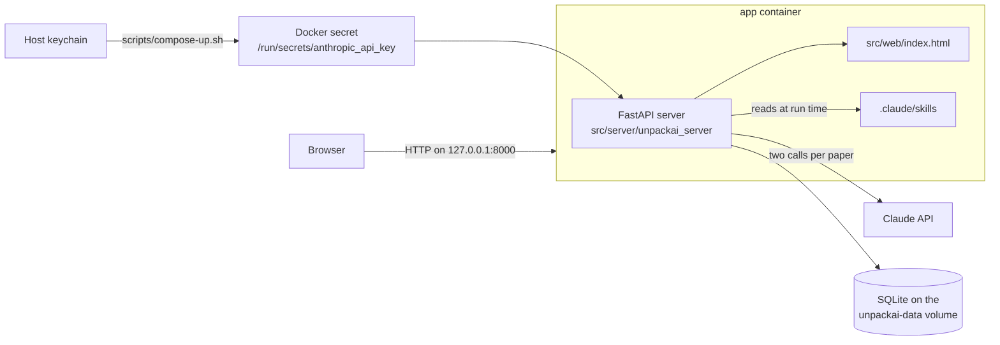

# System architecture

UnpackAI has a single prototype page and a small Python server, and Docker Compose runs both of them with a SQLite database on a volume. The server makes every call to Claude, so the browser never needs the API key.

## Style

| Part | Choice |
| --- | --- |
| Page | One HTML file with vanilla JavaScript, CSS, and inline SVG, and no build step |
| Server | Python 3.13, FastAPI, and uvicorn, with the official `anthropic` SDK |
| Storage | SQLite in WAL mode, on the `unpackai-data` volume |
| Deployment | Docker Compose on one computer, published on 127.0.0.1 only |

## Page

The page in `src/web/index.html` has three parts:

- The command bar at the top takes an arXiv link, a PDF URL, or a blog URL. The Unpack button sends the link to the server, and the bar shows each step of the unpack while the server works.
- The library on the left lists the papers that the server stored, and then the three sample dossiers. You can filter the library by area, e.g., architecture or data, and each stored paper shows its status, e.g., unpacking or failed.
- The dossier on the right explains one paper in tabs.

You add each paper by hand, because UnpackAI doesn't collect new papers on its own. ADR 010 records the choice.

The page calls the server only when the server serves the page. When you open `src/web/index.html` as a file, e.g., in the checks container, the page shows the sample dossiers, and the Unpack button says how to start the server.

The page routes between dossiers and tabs with the URL hash, in the form `#<dossier id>-<tab>`, e.g., `#fineweb-filters`. A stored dossier has the id `p` followed by the paper id, e.g., `#p12-overview`. The `DOCS` table in the script lists the tabs of each dossier, and the page adds a stored dossier to the table when it loads the dossier.

The colors have a fixed meaning on every page. Yellow marks an idea that is new in the paper, blue marks an idea from earlier work, and grey marks standard practice. The page defines every color as a token on `:root` with a second set for dark mode.

### Dossier structure

Every dossier starts with an Overview tab and ends with an Evidence tab. The Overview tab has a table of the paper's new ideas with what each idea replaces and why it works, and the Evidence tab tags each claim by the kind of evidence behind it. The tabs in between depend on the paper type, because each type puts its new ideas in a different place.

| Paper type | Complete dossier in the page | Tabs between Overview and Evidence |
| --- | --- | --- |
| Model paper | DeepSeek-V3 Technical Report (arXiv 2412.19437), id `dsv3` | Architecture, Data, Training loop |
| Dataset paper | The FineWeb Datasets (arXiv 2406.17557), id `fineweb` | Pipeline, Filters, Deduplication, FineWeb-Edu |
| Systems paper | FlashAttention (arXiv 2205.14135), id `flash` | Bottleneck, Algorithm, Performance |

The model dossier has a simulation of how the router balances work across experts, a KV cache calculator, a learning rate timeline, and an FP8 rounding heatmap. Its Data tab shows which parts of the data preparation the report discloses, with examples of fill-in-the-middle and document packing.

The dataset dossier has a pipeline diagram, a filter tester that computes page statistics from example pages, and a simulation of the two ways to deduplicate across crawl snapshots. Its Evidence tab also lists what the authors released, e.g., the data, the code, and the ablation models.

The systems dossier has a roofline estimate that shows why standard attention is limited by memory traffic, and an animation of the loop over tiles. It also has a worked example of the online softmax and a calculator that compares HBM traffic for standard attention and FlashAttention. Its Performance tab names the baseline for each speedup, because the paper uses different baselines for different results.

### Unpack progress

While an unpack runs, the page asks the server for the paper every three seconds, and the command bar marks the step that is running. The steps are the queue, the extract call, the plain-writing call, and the text check. When an unpack fails, the bar marks the step that failed, and it shows the error with a Try again button. You can also open the progress of a paper from the library.

### Stored dossiers

The page builds a stored dossier from the JSON that the server returns, when you open the dossier from the library. ADR 011 records the choice. The dossier has the tabs from the extract call, and it ends with a Text check tab.

- The first tab has the table of new ideas. The last tab before Text check has the claims, the numbers with their sources, and the information that the paper doesn't give.
- Each tab in between has its introduction, the new ideas that the tab explains, and the figures that the extract call suggests. The page doesn't build interactive figures for stored dossiers yet, so each suggested figure shows its title and its "What to notice" note.
- The Text check tab lists each problem that the server's text check found, with the name of the field and its text. It also lists the calls to Claude, with the model that answered each call and the token counts.

The paper head says how many problems the text check found, with a link to the Text check tab. The page escapes every value from the server before it adds the value to the page, because the text comes from a paper or a web page.

## Server

The server in `src/server/unpackai_server/` takes a source, e.g., an arXiv link, a PDF URL, a blog URL, or pasted text, and it unpacks the source in the background. It makes two calls to Claude for each source, and it stores both calls in the database.

1. The extract call reads the source and fills in the dossier fields. The system prompt includes the unpack skill from `.claude/skills/unpack/SKILL.md`, so the server follows the same rules as Claude Code. An arXiv paper or PDF goes to Claude as a document URL, and a blog post is read with the web fetch tool.
2. The plain-writing call rewrites every prose field, with the plain-writing skill from `.claude/skills/plain-writing/SKILL.md` as the system prompt. The server keeps only the rewritten prose. Statuses, evidence labels, and numbers come from the first call, so the rewrite can't change them.

After the second call, the server runs the text check from `text_check.py` on every prose field, and it stores the problems it finds with the dossier. If either skill file is missing, the unpack stops with an error.

Both calls use `claude-opus-5-5` with adaptive thinking and streaming. They also use the `fallbacks: "default"` setting, so if Claude declines a request, the API tries Anthropic's recommended fallback model. The `generations` table records which model answered. You can set a different model with the `UNPACKAI_MODEL` variable when you run `scripts/compose-up.sh`.

### API

| Method and path | What it does |
| --- | --- |
| `GET /` | Serves the page |
| `GET /api/health` | Says whether the Docker secret has a key. It never returns the key. |
| `POST /api/unpack` | Starts an unpack. The body is `{"url": "..."}` with an arXiv link or id, a PDF URL, or a blog URL, or `{"text": "..."}` with the full text. |
| `GET /api/papers` | Lists every paper with its status, which is queued, running, done, or failed |
| `GET /api/papers/{id}` | Returns one paper with its latest dossier, the step that is running or that failed, and the calls to Claude without the raw output |
| `POST /api/papers/{id}/retry` | Starts a failed unpack again from the stored source. A paper from pasted text can't start again this way, because the server stores only a hash of the text. |
| `GET /api/papers/{id}/generations` | Returns every call to Claude for the paper, with the model, the token counts, and the raw output |

The interactive API documentation is at `/api/docs`. If you send the same source twice, the server returns the stored paper without calling Claude again. It calls Claude again only if the first unpack failed. The server drops query strings and fragments from arXiv links, so different links to one paper map to one stored paper.

When the server starts, it marks every paper that was still queued or running as failed, because a stopped server can't finish the unpacks. The server keeps the step of each unpack in memory, so after a restart the page can't show the step where a failed unpack stopped.

### Database

The database is the SQLite file `/data/unpackai.sqlite3` in the `app` container, on the `unpackai-data` volume. It has three tables:

| Table | What it holds |
| --- | --- |
| `papers` | One row for each source, with its status and any error |
| `generations` | One row for each call to Claude, with the request id, the stop reason, the token counts, the time taken, and the raw output |
| `dossiers` | Each finished dossier as JSON, with a version number for each paper and the list of text problems |

The database keeps its schema version in `PRAGMA user_version`. The volume stays when you stop or rebuild the containers, and `docker compose down -v` deletes it with every stored dossier.

### API key

The server reads the Claude API key from the Docker secret `/run/secrets/anthropic_api_key` with `secret_store.py`. The key never appears in the browser, in a request header from the browser, in an environment variable, or in the repository.

First, `scripts/store-key.sh` stores the key in the host keychain under service `unpackai` and account `anthropic_api_key`. Second, `scripts/compose-up.sh` reads the key from the keychain and passes it to Docker Compose in the `UNPACKAI_ANTHROPIC_API_KEY` variable, which only the `docker compose` process can see. Third, Compose copies the value into the container as the secret file. The key isn't written to a file on the host, and it isn't set as a variable in the container.

The server reads the secret when an unpack needs it, so the server starts even when the key is missing. If the key is missing, the unpack fails with a message that says how to pass the key.

### Logging

The logs never contain the API key or request headers, and the server does the following to keep them out:

- The server's request log writes only the method, the path, the status code, and the time taken. The uvicorn access log is turned off, and nothing logs query strings or bodies.
- The Anthropic SDK and the HTTP client libraries are capped at WARNING, and the server removes `ANTHROPIC_LOG` from its environment. At DEBUG level, the SDK logs the full request options and the response headers.
- A filter on every log handler replaces the key, and any `Authorization` or `x-api-key` value, with `[REDACTED]`. The filter is a backup in case a library logs a header anyway.
- The server also removes `ANTHROPIC_API_KEY` and `ANTHROPIC_AUTH_TOKEN` from its environment, so the Docker secret is the only place the SDK can get a credential.

The test `test_key_comes_from_docker_secret_and_never_reaches_logs_or_responses` checks these rules. It sets the root logger and `ANTHROPIC_LOG` to debug, runs a full unpack, and checks that no log line or API response contains the key or a request header.

## Containers

`compose.yaml` defines three containers. The build context of each one is the repository root, because the images copy the page, the skills, and the server code.

| Container | Image file | What it runs | Command |
| --- | --- | --- | --- |
| `app` | `docker/app.Dockerfile`, target `runtime` | The server, which also serves the page | `scripts/compose-up.sh` |
| `test` | `docker/app.Dockerfile`, target `test` | The server tests in `tests/server/`, with no network access | `docker compose --profile test run --rm --build test` |
| `checks` | `docker/checks.Dockerfile` | The text check and the browser check, with no network access | `docker compose --profile checks run --rm --build checks [dossier id]` |

The `app` container runs as a user without root rights, with every capability dropped and `no-new-privileges` set. Its port is published on 127.0.0.1 only, so other computers can't reach the server, and you can pick another port with the `UNPACKAI_PORT` variable. Anyone who can reach the server can start an unpack and spend your API credit, so keep the port off public networks.

The root filesystem of the `app` container isn't read-only, because Compose copies a secret from an environment variable into the container. ADR 006 explains the choice.

The `checks` container first runs the text check on the page and on the Markdown documentation, except the copied plain-writing skill, whose examples break the rules on purpose. It then runs `tests/web/check_dossiers.js`, which opens every tab of every dossier in Chromium, at desktop width and at phone width.

1. First, the browser check opens the page as a file.
2. Second, it opens the page from the fake server in `tests/web/fake_server.js`. The fake server answers the API requests with a stored dossier, a running unpack, and a failed unpack, so the check needs no network and no key.

The browser check reports script errors, tabs that show the wrong panel, and pages that scroll sideways on a phone. With the fake server, it also checks the library, the progress in the command bar, the Try again button, the Text check tab, and the escaping of HTML from the server. It saves a screenshot of every tab when the repository root has a `shots` folder that anyone can write to, e.g., after `mkdir -p shots && chmod 777 shots`.

On Windows, run the scripts in WSL or Git Bash. When neither `security` nor `secret-tool` is installed, the scripts use the Python `keyring` package on the host.

If your network inspects TLS traffic with its own certificate, the image builds can't download packages. To fix the builds, build a base image that trusts the certificate and pass it with `--build-arg PYTHON_IMAGE=<image>` for `app` and `test`, or `--build-arg PLAYWRIGHT_IMAGE=<image>` for `checks`.

## Built and planned work

The full app would process each new paper in a fixed order, and the server already does part of the work.

| Step | Status |
| --- | --- |
| Add a new paper or blog post | Built. You paste a link in the command bar, and UnpackAI doesn't collect new papers on its own (ADR 010). |
| Read the sections, tables, figures, and equations | Built in part. Claude reads a PDF from its URL and a blog post with web fetch, and the server doesn't use the LaTeX source from arXiv yet. |
| Fill in the dossier fields, e.g., the new ideas, the claims, and the numbers with their sources | Built. The first call returns the fields as JSON. |
| Compare the paper with earlier dossiers, so reused ideas are marked as inherited | Planned. The first call marks an idea as inherited only when the paper cites earlier work for it. |
| Rewrite every paragraph with the plain-writing skill | Built. The second call rewrites the prose, the text check runs on the result, and the Text check tab shows the problems. |
| Show the dossier in the page, with interactive figures filled in from the paper's numbers | Built in part. The page shows each stored dossier, and it lists the suggested figures without building them. |
